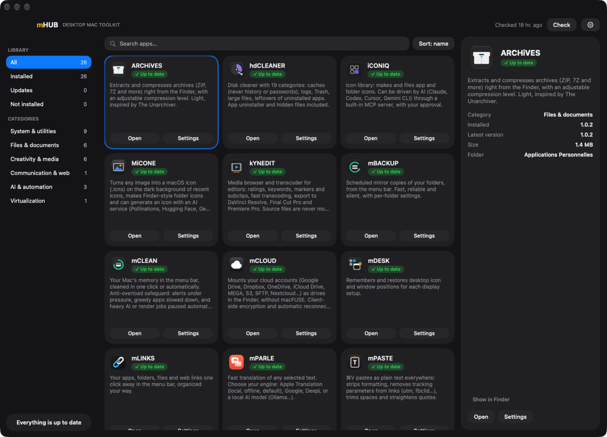

# mHUB

## About

**mHUB** is the hub of the **DESKTOP MAC TOOLKIT**: one menu bar icon to install, update, launch and reach the settings of every toolkit app. Apps are downloaded from their public GitHub releases, verified (Developer ID signature, same team) and installed in `~/Applications/Applications Personnelles`.

Made by Starbudweiser & Claude Code (Anthropic). MIT License. Provided as is, without warranty.

## Fonctionnement

- Catalogue embarqué (`Resources/catalogue.json`, généré par `tools/gen_catalogue.py`).
- Installation / mise à jour : release GitHub publique → vérification de la signature → remplacement ; jamais pendant qu'une appli est ouverte.
- Contrat léger avec les applis : champ `settings` du catalogue (schéma d'URL ou argument de lancement) et notification `fr.stephan.toolkit.presence` pour l'icône de barre des menus.
- Compilation : `./build_app.sh` (version locale installée) ou `DEV=1 ./build_app.sh` (édition de développement `fr.stephan.mhub.dev`).

Voir `ARCHITECTURE.md`.
